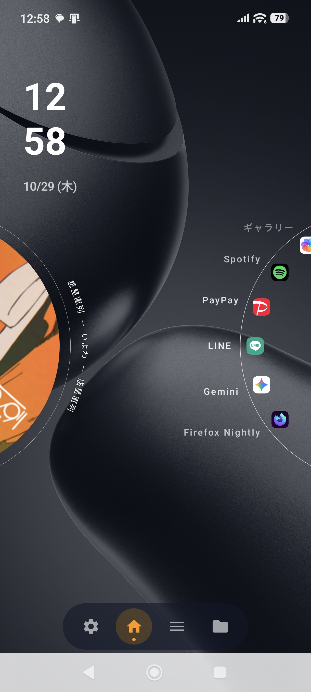
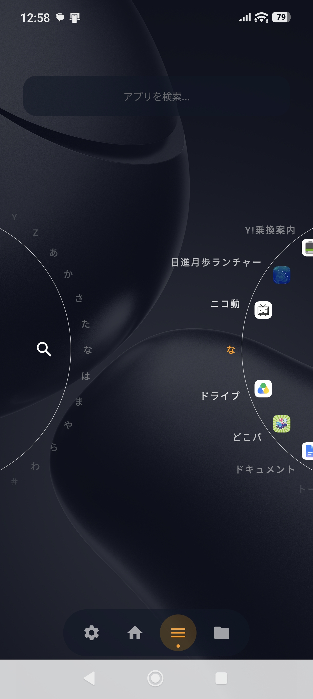
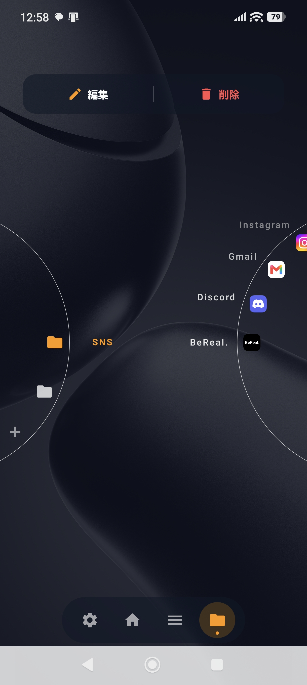
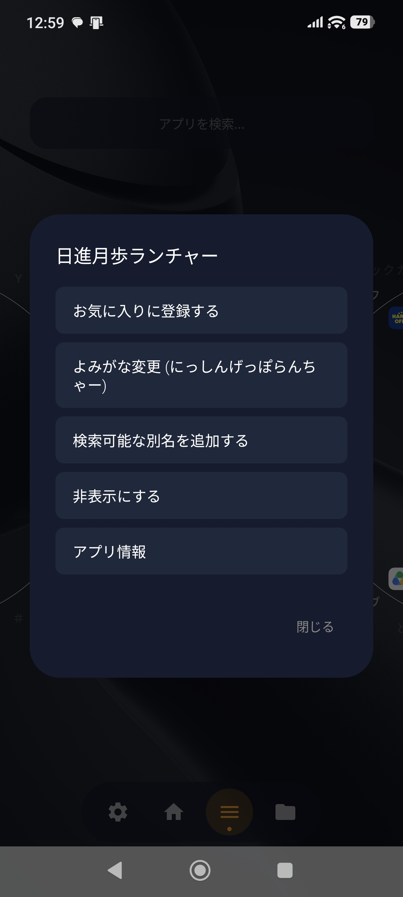
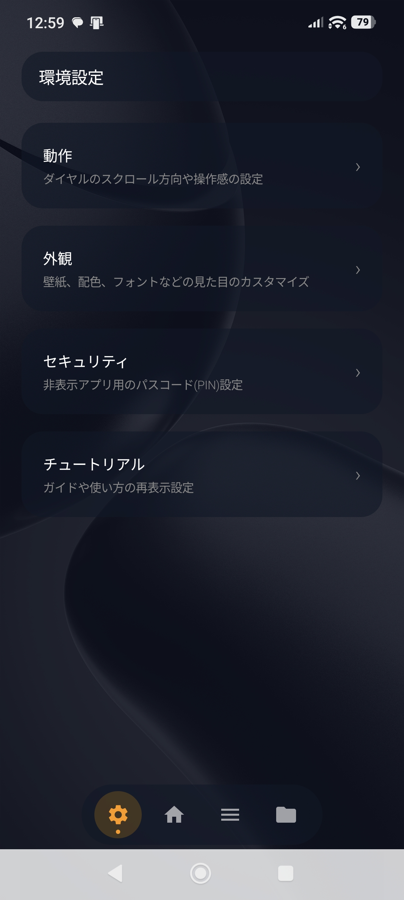
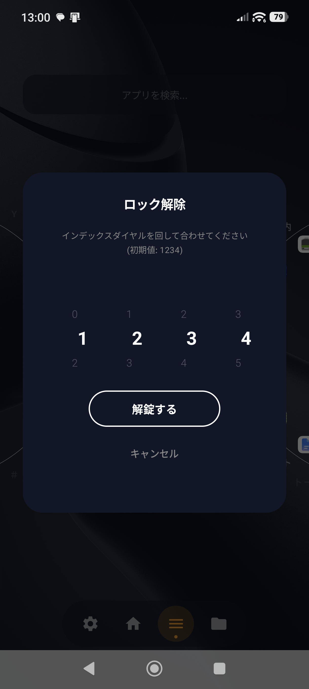
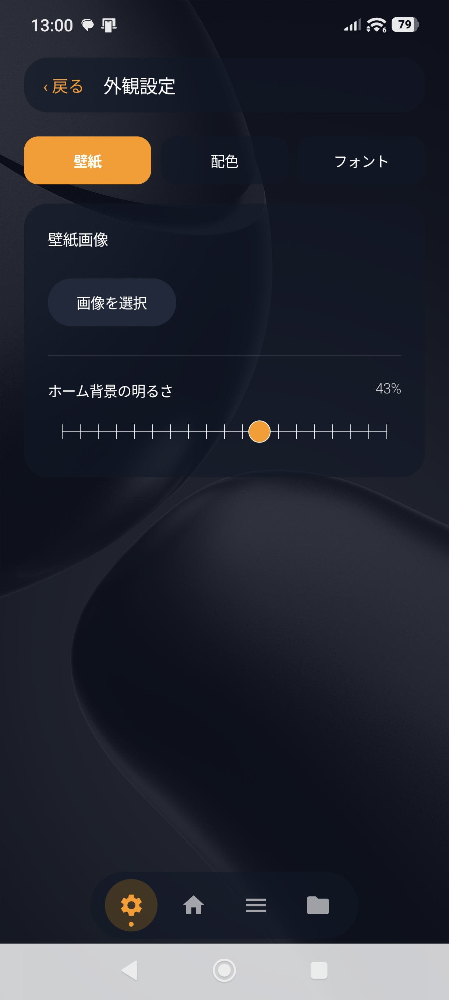
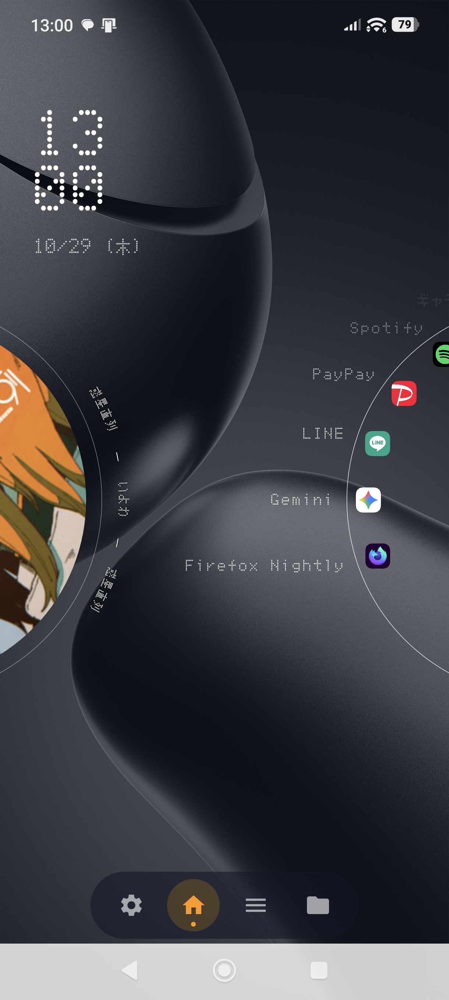

# 🌅 日進月歩ランチャー (Nisshin Geppo Launcher)

<p align="center">
  
  
  
</p>

[](https://github.com/USERNAME/NisshinGeppoLauncher/actions/workflows/build-apk.yml)
[](https://kotlinlang.org)
[](https://developer.android.com/jetpack/compose)
[](LICENSE)

---

## 🎯 コンセプト

従来のランチャーアプリでありがちな**「漢字やカタカナが五十音順やアルファベット順で正常に分類・インデックスされない」**というストレスフルな問題を解決するために開発された、**日本語話者向けに特化したカスタムランチャー**です。

スムーズな片手操作（ワンハンドオペレーション）を可能にするメカニカルな円形UIとダイヤル機構を採用し、日常のスマホ操作をより快適で楽しいものにします。

> **🤖 開発背景について**
> 制作者は **Kotlinの知識が全くありません**。本アプリの設計、コード実装、UI/UXの構築のすべては、**Gemini**（GoogleのAI）との対話を通じて生成・構築されています。

---

## 📥 インストール方法

本アプリのAPKファイルは、GitHubの **Releases** ページから簡単にダウンロードしてインストールいただけます。

1. [Releases ページ](https://github.com/USERNAME/NisshinGeppoLauncher/releases)へアクセスします。
2. 最新のリリースから `app-release.apk`（またはデバッグ用APK）をダウンロードします。
3. Android端末でAPKファイルを開き、インストールを実行してください。
   *(※「提供元不明のアプリ」のインストール許可が必要な場合があります)*

---

## ✨ 主な特徴

- **🌀 メカニカルインデックスダイヤル**
  - 五十音順やアルファベット順、カテゴリ別に素早くアクセスできる円形ダイヤルUI。
  - ダイヤルを回すような滑らかな操作感で目的のアプリに直感的にアクセスできます。
- **🎵 レコード風ミュージックウィジェット**
  - 再生中の音楽やアルバムアートをターンテーブル（レコード盤）のグラフィックでスタイリッシュに表示。
- **📁 柔軟なフォルダ管理 & アプリカスタマイズ**
  - SNSやツールなど、用途に応じたフォルダ作成と整理。
  - アプリの「よみがな変更」や「検索用別名の追加」で、独自の読み方でも素早く検索可能。
- **🔒 セキュリティ＆プライバシー保護**
  - 非表示設定したアプリをダイヤルキーやPINコード（インデックスダイヤル式ロック）でしっかり保護。
- **🎨 高度なカスタマイズ性**
  - 壁紙、ホーム背景の明るさ、アクセントカラー、フォント（レシート風フォント等）のカスタマイズ。
  - ダイヤルのスクロール方向や操作感の微調整。

---

## 📱 スクリーンショット

|            ホーム画面 / ウィジェット            |            アプリ検索・インデックス             |              フォルダ & 編集モード              |
|:-----------------------------------------------:|:-----------------------------------------------:|:-----------------------------------------------:|
|  |  |  |

|           アプリメニュー・オプション            |                 設定メイン画面                  |          ロック解除画面 (PIN/ダイヤル)          |
|:-----------------------------------------------:|:-----------------------------------------------:|:-----------------------------------------------:|
|  |  |  |

|                外観・テーマ設定                 |                  フォント変更                   |
|:-----------------------------------------------:|:-----------------------------------------------:|
|  |  |

---

## 🛠️ 技術スタック

- **言語**: [Kotlin](https://kotlinlang.org/)
- **UI フレームワーク**: [Jetpack Compose](https://developer.android.com/jetpack/compose) / Material 3
- **非同期処理**: Kotlin Coroutines & Flow
- **CI/CD**: GitHub Actions (`build-apk.yml`)

---

## 💻 開発者向けビルド方法 (ソースコードからビルドする場合)

```bash
# リポジトリのクローン
git clone https://github.com/USERNAME/NisshinGeppoLauncher.git
cd NisshinGeppoLauncher

# デバッグAPKのビルド
./gradlew assembleDebug
```
ビルドされたAPKは `app/build/outputs/apk/debug/app-debug.apk` に出力されます。

---

## 🐛 バグ報告・ご要望について

本アプリはAI（Gemini）を活用して開発されているため、予期せぬバグや改善点が含まれている可能性があります。
不具合の報告や新しい機能のアイデア、改善案などがございましたら、ぜひお気軽に [GitHub Issues](https://github.com/USERNAME/NisshinGeppoLauncher/issues) までご投稿ください！

---

## 📄 ライセンス
このプロジェクトは [MIT License](LICENSE) の下で公開されています。
